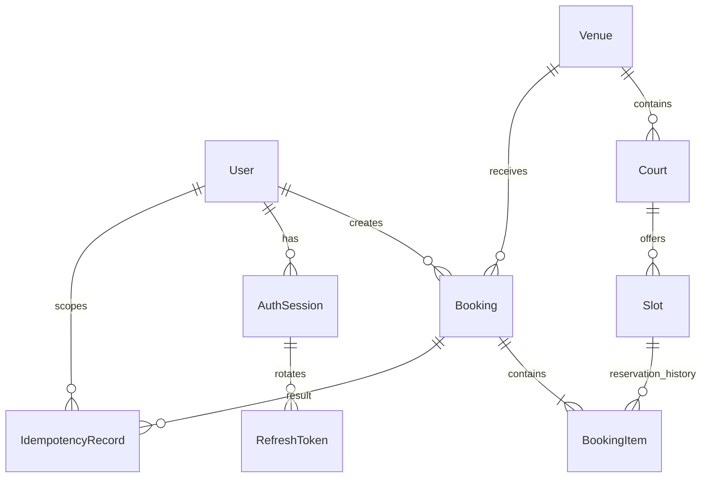

# Data model: first implementation milestone

## Confirmed product rules

- A venue has independently bookable courts/resources, each with a sport.
- Admins generate dated slots using a chosen duration, defaulting to 60 minutes.
  Any leftover period is shown in the preview and explicitly acknowledged; it
  creates no slot. Generation/preview APIs are implemented; the UI follows.
- A booking contains arbitrary slots across courts and dates within one venue.
- Confirmation is all-or-nothing, with no temporary basket holds.
- Customer cancellation is per item and allowed only when its start is strictly
  more than 12 hours away. Exactly 12 hours is ineligible.
- Admins may cancel upcoming items without that cutoff, with a reason.
- Reserved slots cannot have their court, times, or price silently edited.
- Public browsing and selection precede authentication. Valid sessions continue
  through confirmation without another sign-in step.

## Relationships

`BookingItem` is the reservation. A slot can have many historical cancelled
reservations, but at most one `RESERVED` item. Completion is derived from the
item's end time; it is not a background job that updates reservation status.

## Tables

| Model | Responsibility |
| --- | --- |
| User | Normalized unique email, name, password hash, customer/admin role, active flag. |
| AuthSession | JWT session identity, expiry, revocation. |
| RefreshToken | Hash-only refresh credentials, consumed-token history for rotation/replay checks. |
| Venue | Facility information, timezone, currency, image URL, active flag. |
| Court | Named resource and sport within a venue. |
| Slot | Dated interval, price in minor units, block state, version. |
| Booking | Customer and venue, reference, customer contact snapshots. |
| BookingItem | Slot reservation, immutable confirmed snapshots, cancellation metadata. |
| IdempotencyRecord | Customer/operation/key scope, request hash, successful response, related booking. |

Sports are court attributes; venue sports are derived from their courts. There
is no extra sports catalog, payment, review, or analytics subsystem.

## Database-enforced invariants

- UUID primary keys and restrictive foreign keys preserve reservation history.
- Composite foreign keys connect every booking item to a booking and slot with
  the same `venue_id`, and every slot to a court in that venue.
- A GiST exclusion constraint rejects overlapping intervals for the same court,
  including blocked slots. Bounds are `[start, end)`, so adjacent slots are valid.
- A partial unique index permits only one `RESERVED` booking item per slot.
- Times must have `ends_at > starts_at`; prices are non-negative integer minor
  units. INR 500.00 is stored as 50000, avoiding floating-point money arithmetic.
- Slot triggers protect reserved schedule/price fields, control the version,
  and coordinate reservation creation with blocking/editing through a row lock.
- Booking item snapshots are validated on creation and immutable afterward;
  cancellation is one-way. Cancellation metadata must match the item status.
- Token/request hashes are 64-character lowercase SHA-256 hex strings. Session
  and credential timestamps must be internally consistent.
- Only one unconsumed refresh token exists per session; rotation must consume
  the old token and insert its replacement in one transaction.
- Idempotency keys are unique within a user and operation. Only successful
  responses are stored; retain their mapping alongside booking history.

`btree_gist` supplies UUID equality for the court/time exclusion constraint.
Migration SQL is authoritative for PostgreSQL-specific protections; Prisma
models document those additions but do not express all of them.

## Transaction protocol for the next milestone

1. Authenticate and validate the selection; reject duplicate slot IDs.
2. Begin a Read Committed transaction and coordinate the scoped idempotency key.
3. Lock all selected slot rows in ascending immutable ID order.
4. Run a fresh reservation query after acquiring locks. Revalidate the venue,
   court activity, block state, future start, slot versions, and reviewed prices.
5. Create the booking, all item snapshots, and the successful idempotency record
   within the same transaction. Commit before returning success.
6. Translate a reservation uniqueness conflict to a useful HTTP 409. Retry
   deadlocks only within a bounded policy and preserve the idempotency key.

Cancellation and admin updates must use the same slot-first locking order.
For maintenance, cancel affected reservations before blocking their slots,
within the same transaction. Never mark a slot available using a separate flag:
availability is future + open + active venue/court + no reserved item.

## Service responsibilities

Authentication and venue services now implement JWT verification, role/ownership
guards, venue/court activity checks, normalization, timezone validation, bounded
slot generation, atomic generation batches, and versioned slot edits.
The booking/cancellation milestone will add the 12-hour cutoff using server time
after locks are acquired, booking price/version consent, idempotency replay and
payload comparison. It will also ensure that a successful booking has at least
one item. A foreign key alone cannot enforce that a parent has children.

Slot versions change when court, time, price, or block state changes. Confirmation
must compare the version from the review; a mismatch requires fresh consent.

Absolute times use PostgreSQL `timestamptz`; the venue stores its IANA timezone
separately because `timestamptz` does not retain the original timezone name.
INR and `Asia/Kolkata` are defaults. The service validates supported currencies,
venue-local date boundaries, and timezone names.

Booking and item records preserve original details. Display original, cancelled,
and remaining totals by summing item snapshots; avoid an independently mutable
booking total or status. Archive venues/courts using their active flags; deleting
referenced history is restricted. Keep default database isolation at Read
Committed when using the documented explicit-lock protocol.

## Security boundary

Passwords are Argon2id hashes generated by the auth service. High-entropy
refresh tokens use SHA-256 hashes; this is not a password hashing strategy.
JWTs, raw refresh tokens, signing secrets, and user credentials are never stored
in idempotency responses or committed to source control. Response serialization
must explicitly select public fields; never return a complete User row.

Use a migration role for DDL and a restricted runtime role for ordinary queries.
The application owns client connection lifetime. See [venues and slots](venues-and-slots.md)
for implemented availability and generation services, and [authentication](authentication.md)
for the session lifecycle.

## Reference documentation

- [PostgreSQL range constraints](https://www.postgresql.org/docs/current/rangetypes.html#RANGETYPES-CONSTRAINT)
- [PostgreSQL partial unique indexes](https://www.postgresql.org/docs/current/indexes-partial.html)
- [PostgreSQL row locks](https://www.postgresql.org/docs/current/explicit-locking.html#LOCKING-ROWS)
- [Prisma custom migrations](https://www.prisma.io/docs/orm/v7/prisma-migrate/workflows/unsupported-database-features)
- [Prisma release status](https://www.prisma.io/docs/orm/release-status)
